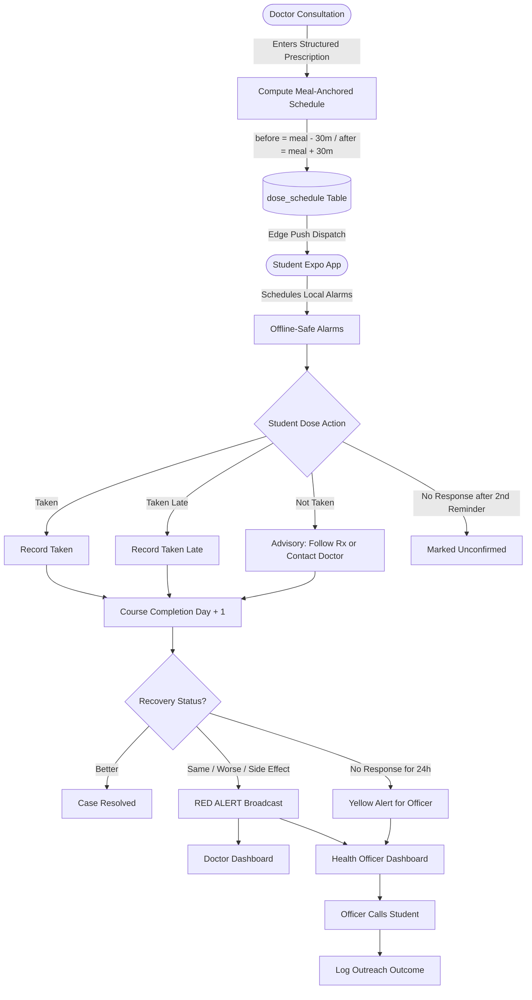

# KIET Smart Care

**Campus Healthcare System for KIET Group of Institutions, Korangi, India**

KIET Smart Care is a closed-loop institutional healthcare monitoring platform that connects the Campus OPD Doctor, Campus Health Officer, Institutional Administrator, and Students into an integrated care network.

---

## 1. System Purpose & Core Value Proposition

When a student visits the campus clinic, the doctor records their medical complaint and structured prescription using the student's unique institutional roll number. 

The student's mobile device receives the structured prescription and automatically generates meal-anchored medicine reminders tied to the student's personal breakfast, lunch, and dinner schedule. The student confirms each dose in real time (`Taken`, `Taken late`, or `Not taken`).

Upon completion of the medication course, the student answers a 1-tap recovery inquiry (`Better`, `Same`, or `Worse`). If the student reports `Same`, `Worse`, or flags an unexpected `side effect`, a high-priority **RED ALERT** is immediately broadcasted to both the prescribing doctor and the Campus Health Officer. The officer can review the flagged category, initiate immediate telephonic outreach to the student, and log the clinical resolution.

---

## 2. Roles & Permissions Boundary

| Role | Access Scope | Limitations / Protections |
| :--- | :--- | :--- |
| **admin** | Creates staff accounts (doctor/officer), onboards student rosters, manages institution-wide settings. | **Strictly prohibited** from reading clinical notes, diagnoses, prescriptions, dose events, or recovery checks. Enforced by database RLS. |
| **doctor** | Looks up students by roll number, logs clinical visits and vitals, enters structured prescriptions, and monitors red alerts for their own patients. | Cannot edit closed/past medical records. Cannot bypass student consent records. |
| **officer** | Read-only campus-wide surveillance overview. Monitors aggregate epidemiological counts, views flagged cases, executes telephonic outreach, and logs outreach outcomes. | **Does NOT approve prescriptions.** Medical details open only for flagged cases and show the problem category (not raw clinical doctor notes). Every view is recorded in `audit_logs`. |
| **student** | Uses the Expo mobile application to receive notifications, record dose adherence, review past visits, and submit post-course recovery status. | Can **only read and write their own data**. Always has an unblockable Emergency Contact button. |

---

## 3. Technology Stack

- **Web Application (`apps/web`)**: Next.js 15 (App Router, TypeScript, Tailwind CSS, shadcn/ui). A unified deployment hosting:
  - Doctor Portal (`/doctor`)
  - Officer Portal (`/officer`)
  - Admin CRM (`/admin` and served on the admin subdomain)
  - API Routes (`/api/`) for privileged institutional server actions
- **Mobile Application (`apps/student`)**: Expo React Native (TypeScript, `expo-router`, `expo-notifications`) for student devices.
- **Shared Package (`packages/shared`)**: Shared TypeScript types, Zod schemas, constants, and timing offsets.
- **Backend & Persistence (`supabase/`)**: Supabase (PostgreSQL, Supabase Auth, Row Level Security, Storage, pg_cron, and Deno Edge Functions). No separate custom backend server.
- **File Storage**: Private Supabase Storage buckets only (`prescriptions`, `medical-records`, `audit-exports`). Never public URLs; always accessed via short-lived signed URLs.

---

## 4. Repository Structure

```
kiet-smart-care/
├── apps/
│   ├── web/
│   │   ├── app/
│   │   │   ├── (doctor)/
│   │   │   │   └── doctor/          # Doctor OPD pages under /doctor
│   │   │   ├── (officer)/
│   │   │   │   └── officer/         # Campus Health Officer dashboard under /officer
│   │   │   ├── (admin)/
│   │   │   │   └── admin/           # Admin CRM under /admin (and admin subdomain)
│   │   │   ├── api/                 # Server routes for privileged server actions
│   │   │   ├── globals.css          # Tailwind & shadcn theme tokens
│   │   │   ├── layout.tsx           # Global root layout
│   │   │   └── page.tsx             # Central staff login entry point
│   │   ├── components/ui/           # shadcn/ui component primitives (Button, Card, Input, etc.)
│   │   ├── lib/                     # Client utilities (cn, formatting)
│   │   └── middleware.ts            # Role-based route protection and admin subdomain rewrite
│   └── student/
│       ├── app/
│       │   ├── _layout.tsx          # Root navigation layout
│       │   └── index.tsx            # Main student screen with black cards and emergency button
│       ├── app.json                 # Expo configuration & notification permissions
│       ├── babel.config.js          # Expo Babel preset
│       └── package.json             # Expo dependencies
├── packages/
│   └── shared/
│       ├── src/
│       │   ├── constants/           # Roles, meal timing offsets, alert triggers
│       │   ├── types/               # TypeScript interfaces for entities & profiles
│       │   ├── validators/          # Zod validation schemas
│       │   └── index.ts             # Barrel export
│       ├── package.json
│       └── tsconfig.json
├── supabase/
│   ├── config.toml                  # Supabase local development configuration
│   ├── migrations/                  # SQL migrations & RLS policies
│   │   └── 20261031000000_schema_architecture.sql
│   └── functions/                   # Supabase Deno Edge Functions
│       ├── schedule-alerts/         # pg_cron scheduled jobs & escalation sweeps
│       └── send-push/               # Push notification dispatch service
├── .env.example                     # Environment template for Web, Student & Supabase
├── package.json                     # Monorepo root workspace configuration
└── README.md                        # Architecture blueprint and guide
```

---

## 5. Authentication & Role Separation

Staff members (Doctor, Officer, Admin) authenticate on a single unified login page.
1. The user's role is stored in the authenticated `profiles` table.
2. Next.js `middleware.ts` intercepts incoming requests, verifies credentials, and immediately redirects the user to their designated portal:
   - `doctor` $\rightarrow$ `/doctor`
   - `officer` $\rightarrow$ `/officer`
   - `admin` $\rightarrow$ `/admin` (or `admin.kiet...` subdomain)
3. Direct navigation to unauthorized paths is rejected at the middleware boundary.
4. Admin portal routes open **only** for users authenticated with the `admin` role.

---

## 6. Core Medical & Reminder Workflow



### Meal-Anchored Timing Rules
- **After Meal**: `Student Meal Time + 30 minutes`
- **Before Meal**: `Student Meal Time - 30 minutes`
- Default meal timings (configurable by student): Breakfast `08:00`, Lunch `13:00`, Dinner `20:00`.
- All alarms are created as local notifications on the student device to ensure alarms trigger even when offline or in airplane mode.

---

## 7. Safety Invariants (Never Break)

1. **Zero Automated Medical Prescriptions**: The platform **never** diagnoses, recommends medications, or modifies dosages. It only schedules what the licensed doctor explicitly entered.
2. **Never Double Missed Doses**: When a dose is missed, the system strictly forbids advising a double dose. The mandatory message reads: *"Never double up on a missed dose. Follow your prescription directions or contact your doctor for guidance."*
3. **Immediate Escalation for Side Effects**: Any side effect report surfaces a persistent **Contact Doctor** button and immediately triggers a red alert.
4. **Permanent Emergency Contact**: An emergency campus contact action is permanently pinned and accessible in the student app.
5. **Immutable Medical History**: Prior visit logs and prescriptions are permanent medical history and can never be updated or deleted.

---

## 8. Privacy & Data Governance (RLS Architecture)

1. **Row Level Security (RLS)** is applied to every database table.
2. **Student Privacy**: Students can select and read only rows where `student_id = auth.uid()`.
3. **Admin Segregation**: Database RLS prevents users with the `admin` role from reading `visits`, `medicines`, `dose_schedule`, and `recovery_checks`.
4. **Officer View Auditing**: The Health Officer dashboard presents aggregate statistics by default. When an officer views an escalated student case, only the high-level `problem_category` is shown (full clinical doctor notes remain restricted), and the action is written to `audit_logs`.
5. **Student Consent**: Students review and accept the healthcare terms upon first login; consent details (timestamp, version, IP address) are stored in `consent_records`.

---

## 9. UI Direction Per Portal

- **Student App**: White background, near-black typography (`#121212`), high-contrast black cards (`#0a0a0a`), Google-clean, luxurious, and accessible.
- **Doctor Portal**: Clean white and healthcare blue (`#2563eb`), optimized for rapid entry during busy OPD clinics.
- **Health Officer Portal**: Luxurious enterprise executive dashboard in blue and white, centered around aggregate surveillance metrics and flagged case queues.
- **Admin CRM**: Strictly minimalist black and white (`#000000` / `#ffffff`), monospace typographic elements, emphasizing security and zero medical access.

---

## 10. Development & Build Roadmap

1. **Stage 1 (Next)**: Supabase schema, types, migrations, and Row Level Security policies.
2. **Stage 2**: Admin CRM (Staff account creation, student roster onboarding).
3. **Stage 3**: Doctor Portal (Student lookup by roll number, visit & prescription entry, alerts).
4. **Stage 4**: Student Mobile App (Meal-anchored local notifications, dose response, recovery check, offline mode).
5. **Stage 5**: Scheduled Jobs & Alerts (pg_cron triggers, Edge Functions, push notifications).
6. **Stage 6**: Officer Portal (Surveillance metrics, flagged case management, outreach logging).
7. **Stage 7**: Comprehensive Security Pass & Audit Verification.

---

## 11. Local Development Quickstart

### Prerequisites
- Node.js `v20+` or `v22+`
- npm `10+`
- Supabase CLI

### Setup
```bash
# Clone and enter workspace
cd kiet-smart-care

# Install workspace dependencies
npm install

# Build shared package
npm run build:shared

# Run Next.js Web Application (Doctor, Officer, Admin)
npm run dev:web

# Run Student Expo Application
npm run dev:student
```
